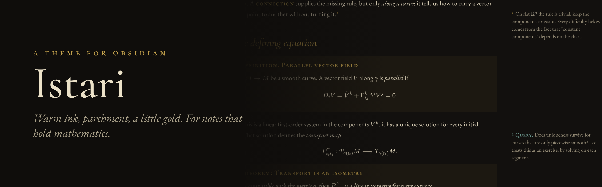
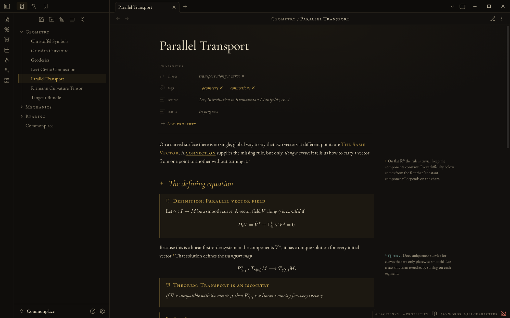
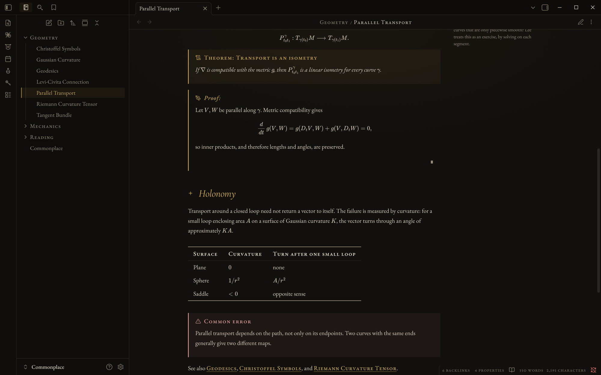
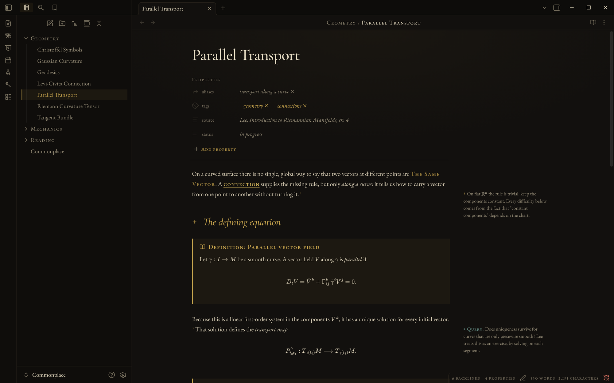
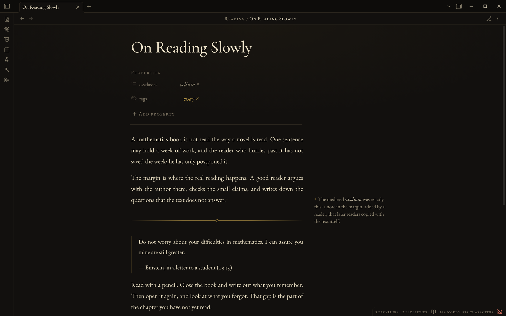
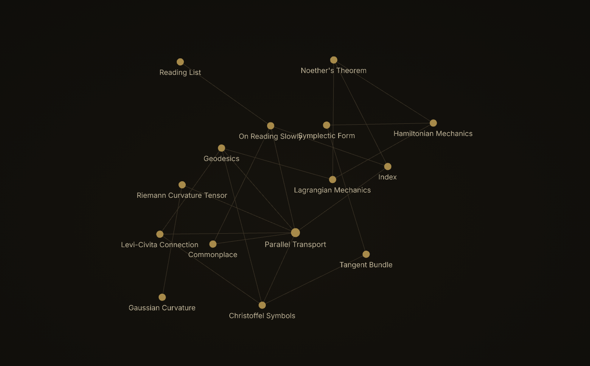

<p align="center"></p>

Istari is the Obsidian theme I wanted while reading a differential geometry textbook at two in the morning. I wanted one built for a book: a warm, dim page, Garamond type, theorems that look like theorems, etc... but in a beautiful, easy-on-the-eye dark color scheme.

**[See it in full →](https://thescholium.github.io/istari)**



**It is set like a book.** EB Garamond for text, Cormorant Garamond for titles, JetBrains Mono for code. Old-style figures in sentences, lining figures in tables. Bold and links are small capitals instead of heavy black. Tables use horizontal rules only. (I have a thing for old math books.)

**Theorems look like theorems.** There are callouts for `theorem`, `definition`, `lemma`, `proposition`, `corollary`, `proof`, `axiom`, `conjecture`, `example`, `remark`, `intuition` and `exercise`. Results are set in italics. Proofs end with ∎. Every callout uses the same gold, so a page with twelve of them won't make your head hurt. Only warnings turn a pale red.

**Footnotes go in the margin**, with the free [Istari Companion](https://github.com/TheScholium/istari-companion) plugin. Start one with `? ` and it becomes a *query*, so your open questions stand out from your explanations.

**It works offline.** The fonts are built into the theme. Istari never loads anything from the internet.

| | |
| --- | --- |
|  |  |
|  |  |

## Install

In Obsidian: **Settings → Appearance → Themes → Manage**, search for **Istari**, then **Install and use**.

Or by hand: download `theme.css` and `manifest.json` from the [latest release](https://github.com/TheScholium/istari/releases/latest) into `<your vault>/.obsidian/themes/Istari/`.

Requires Obsidian 1.8 or later. Istari is dark only; it stays dark even if Obsidian is set to light.

## Writing with it

**Callouts.** Write the type, and Istari adds the label:

```markdown
> [!theorem] Transport is an isometry
> If $\nabla$ is compatible with $g$, then $P^\gamma$ is a linear isometry.

> [!proof]
> Metric compatibility gives $\frac{d}{dt}\, g(V,W) = 0$.
```

Add `|plain` to drop the label: `> [!theorem|plain] Stokes`. Short forms work too: `thm` and `def`.

**Sidenotes.** Write normal footnotes. With the companion plugin, they move to the margin:

```markdown
A connection supplies the missing rule, but only along a curve.^[On flat
space the rule is trivial: keep the components constant.]
```

**Vellum.** For essays and long reading notes, add `cssclasses: vellum` to the properties. The column gets narrower, the type gets bigger, and the text is justified.

**PDF export.** Istari prints in dark ink on white paper, keeps headings with their text, and does not split a callout or a table across two pages.

- Plugins that use Obsidian's color variables pick up Istari's muted palette by themselves. [Integrated Task Manager](https://github.com/kuberrr0/obsidian-integrated-tasks) has its own styling.
- Canvas cards and the graph view use the same palette. The ribbon icons are replaced with hand-drawn ones: a loupe, a codex, a key, an hourglass.
- Code: [MIT](LICENSE). Fonts: [SIL Open Font License 1.1](LICENSES/OFL-1.1.txt).

Made by [The Scholium](https://github.com/TheScholium), who also makes [study templates](https://thescholium.github.io/scholium) for Supernote and reMarkable.
