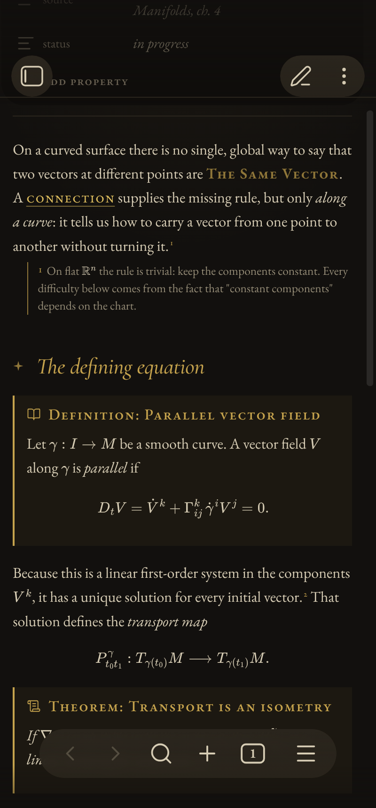

# Istari

A dark, scholarly theme for Obsidian. Warm ink, parchment text, restrained gold, and Garamond type, set like a well-made book. Made for notes that hold mathematics, and for readers who write in the margin.


**Website:** [thescholium.github.io/istari](https://thescholium.github.io/istari)

## Contents

- [Features](#features)
- [Installation](#installation)
- [Mathematical callouts](#mathematical-callouts)
- [Sidenotes](#sidenotes)
- [Vellum, for long-form writing](#vellum-for-long-form-writing)
- [Export to PDF](#export-to-pdf)
- [Plugin support](#plugin-support)
- [Companion plugin](#companion-plugin)
- [License](#license)

## Features

- **Book typography.** EB Garamond for text, Cormorant Garamond for titles, JetBrains Mono for code. Old-style figures in prose, lining figures in tables and code. Bold and links are set in small capitals.
- **Fonts are built in.** All fonts are embedded in `theme.css`. The theme makes no network requests and looks the same offline.
- **Callouts for mathematics.** Theorem, definition, lemma, proposition, corollary, proof, and more, each with its own icon and title. Statements of results are set in italics. Proofs end with a tombstone.
- **Sidenotes.** With the companion plugin, footnotes move into the right-hand margin, beside the line that cites them, in Reading view and in Live Preview.
- **Quiet details.** Booktabs tables with horizontal rules only. A small star before each second-level heading. A thin gold rule with a diamond for `---`. Properties set as small-caps labels.
- **Reading view and Live Preview agree.** Headings, rules, tables, tags, and quotes look the same in both modes.
- **Mobile.** Smaller type and margins on phones and tablets. Sidenotes open in place under their line.
- **Graph, canvas, and icons.** A star-chart graph view, canvas colors from the same palette, and hand-drawn replacement icons for the ribbon.

Istari is a dark theme only. If Obsidian is set to light mode, Istari stays dark.

| | |
| --- | --- |
|  |  |
|  |  |

<p align="center"></p>

## Installation

### From Obsidian

1. Open **Settings → Appearance**.
2. Under **Themes**, select **Manage**.
3. Search for **Istari**, then select **Install and use**.

### Manually

1. Download `theme.css` and `manifest.json` from the [latest release](https://github.com/TheScholium/istari/releases/latest).
2. Put both files in `<your vault>/.obsidian/themes/Istari/`.
3. Restart Obsidian, then select Istari under **Settings → Appearance → Themes**.

## Mathematical callouts

Write a callout with one of these types:

```markdown
> [!theorem] Transport is an isometry
> If $\nabla$ is compatible with $g$, then $P^\gamma$ is a linear isometry.

> [!proof]
> Metric compatibility gives $\frac{d}{dt} g(V,W) = 0$.
```

| Type | Short form | Title prefix | Body |
| --- | --- | --- | --- |
| `theorem` | `thm` | Theorem: | italic |
| `definition` | `def` | Definition: | upright |
| `lemma` | | Lemma: | italic |
| `proposition` | | Proposition: | italic |
| `corollary` | | Corollary: | italic |
| `axiom` | | Axiom: | italic |
| `conjecture` | | Conjecture: | italic |
| `proof` | | *Proof:* | upright, ends with ∎ |
| `example` | | Example: | upright |
| `remark` | | Remark: | upright |
| `intuition` | | Intuition: | upright |
| `exercise` | | Exercise: | upright |

- Every callout uses the same gold. Types are told apart by icon, title, and italics, so a page full of results stays calm.
- The warning family (`warning`, `caution`, `danger`, `error`, `bug`, `failure`, `missing`) uses a pale red.
- To remove the title prefix, add `|plain`: `> [!theorem|plain] Stokes`.
- Without the companion plugin, an untitled callout shows its type twice ("Theorem: Theorem"). The plugin removes the second one.

## Sidenotes

Sidenotes need the [companion plugin](#companion-plugin).

```markdown
A connection supplies the missing rule, but only along a curve.^[On flat space
the rule is trivial: keep the components constant.]

The solution is unique.^[? Does this hold for piecewise smooth curves?]
```

- Inline footnotes `^[...]` and labelled footnotes `[^1]` both become sidenotes.
- A note that begins with `? ` is a **query**. It is labelled in green, so open questions are easy to find later.
- When the note pane is 980 px wide or more, notes sit in the right-hand margin. In a narrow pane or on a phone, select the number to open the note under its line.
- In Live Preview, put the cursor in the note's source to edit it.
- On screen, the footnote list at the end of the note is hidden. When you export to PDF, the footnotes print at the end as usual.

## Vellum, for long-form writing

Add the `vellum` class to a note for a narrower, justified column and larger type:

```yaml
---
cssclasses: vellum
---
```

## Export to PDF

Istari prints in dark ink on white paper. The gold and green are darkened so they keep their contrast. Headings stay with the text that follows them, and callouts, tables, and display math do not split across pages.

## Plugin support

- [Integrated Task Manager](https://github.com/kuberrr0/obsidian-integrated-tasks): panels, chips, and calendar headings in the theme's style.
- Canvas: node colors 1 to 6 use the theme's palette.
- Any plugin that uses Obsidian's color variables (`--color-red`, `--color-green`, and others) gets the muted palette automatically.

## Companion plugin

**Istari Companion** is optional. The theme works without it. It adds three things that CSS alone cannot do:

1. **Sidenotes**, described above.
2. **Callout shorthand.** Type `THEOREM`, `DEFINITION`, `LEMMA`, `PROOF`, or another type name at the start of a line, then a space, colon, or Enter. The line becomes `> [!theorem] `. One undo restores the word.
3. **Clean untitled callouts.** It removes the duplicate type name from callouts that have no title.

To install it:

1. Download `istari-companion.zip` from the [latest release](https://github.com/TheScholium/istari/releases/latest) and unzip it.
2. Put the `istari-companion` folder in `<your vault>/.obsidian/plugins/`.
3. Restart Obsidian. Under **Settings → Community plugins**, turn on **Istari Companion**.

## License

- The theme and the companion plugin: [MIT](LICENSE).
- The embedded fonts, EB Garamond, Cormorant Garamond, and JetBrains Mono: [SIL Open Font License 1.1](LICENSES/OFL-1.1.txt).

Made by [The Scholium](https://github.com/TheScholium). Also see the [Scholium study templates](https://thescholium.github.io/scholium) for Supernote and reMarkable.
